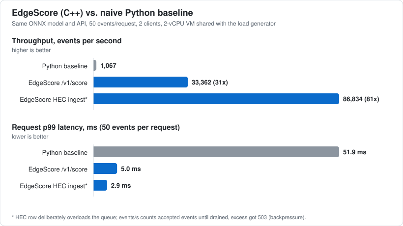

# EdgeScore: C++ ONNX Anomaly Scoring Sidecar

A high-throughput C++17 service that scores streaming telemetry with an ML model and exposes the
results over HTTP and Prometheus metrics, packaged as a Kubernetes sidecar.

An IsolationForest is trained in Python on synthetic host telemetry, exported to ONNX, and served by
a multithreaded C++ pipeline on ONNX Runtime (CPU). Events arrive as newline-delimited JSON, either
through a **Splunk-HEC-compatible** `/services/collector/event` endpoint or a plain NDJSON API, are
micro-batched through a bounded queue with backpressure, and are scored by a worker pool.

## Results: C++ sidecar vs. Python baseline



Before (naive Python, same ONNX model and API) vs. after (EdgeScore), 2-vCPU VM shared with the load generator:

| | Before: Python baseline | After: EdgeScore `/v1/score` | Change |
|---|---:|---:|---:|
| Throughput | 1,067 events/s | 33,362 events/s | **31x** |
| Request p99 (50 events) | 51.9 ms | 5.0 ms | **10x lower** |
| Server-side per-event p50 / p99 | n/a | 1.28 / 3.98 ms | |
| Model calls | 1 per event | 1 per batch (~50 rows) | |
| Threads doing inference | 1 | 2 | |

The HEC ingest path reaches 86,834 events/s on the same machine when the queue is saturated (the excess is
rejected with 503; see the design note). Full table, method and caveats: [Benchmarks](#benchmarks).
Reproduce with `make bench-compare`; regenerate the chart with `python benchmarks/make_chart.py`.

## Features

- **Model training and ONNX export** (`training/`): correlated synthetic telemetry (CPU, memory, latency,
  error rate, request rate, egress) with four injected incident types; IsolationForest; a compact custom ONNX
  export that is checked against scikit-learn on every training run (max abs diff ~2e-7).
- **Ingest**: Splunk HEC envelopes (`{"time","host","event":{...}}`, optional `Authorization: Splunk <token>`,
  HEC-style `{"text","code"}` replies) and bare NDJSON. Streams of concatenated or newline-separated objects,
  `Content-Length` and chunked bodies, keep-alive and pipelining are supported.
- **Multithreaded pipeline**: all-or-nothing enqueue into a bounded queue, N worker threads that form batches
  (`max_batch` rows or `max_wait` µs, whichever comes first) and run one ONNX call per batch. A full queue
  answers **503 + `Retry-After`** (HEC code 9) instead of growing without bound.
- **Observability**: `/metrics` in Prometheus text format with throughput (events/s over 10 s), scored/anomaly/
  rejected counters, queue depth, batch size, a latency histogram plus ready-made **p50/p99** gauges.
- **Verification**: GoogleTest suite (47 tests), pytest suite (6), clean under **ThreadSanitizer** and
  **ASan + UBSan**, Google Benchmark micro-benchmarks, and an end-to-end benchmark against a naive Python baseline.
- **Kubernetes**: manifest with EdgeScore as a native sidecar next to a log-producing demo app, plus a kind
  cluster config and a one-command script.

## Architecture

```
                         ┌──────────────────────── EdgeScore process ────────────────────────┐
 HEC / NDJSON  ──HTTP──► │ HttpServer ─► Service ─► parse_events ─► Pipeline.submit()         │
 (demo app, curl)        │ (thread per    (routes,   (JSON → float   │  all-or-nothing         │
                         │  connection,    auth,      feature rows)  ▼                         │
                         │  keep-alive)    HEC codes)          BoundedQueue ──full──► 503      │
                         │                                          │ pop_batch(≤64, ≤2 ms)    │
                         │                                 ┌────────┴────────┐                 │
                         │                          worker 1 …        worker N                 │
                         │                          Scorer::score(batch) ─► ONNX Runtime (CPU) │
                         │                                 └────────┬────────┘                 │
                         │          Metrics (atomics) ◄─────────────┤──► recent-results ring  │
 Prometheus ◄───/metrics─┤          Completion (sync /v1/score) ◄────┘                         │
                         └─────────────────────────────────────────────────────────────────────┘
 training/train.py ──► models/model.onnx + model.json (features, threshold, metrics) ──► loaded at start
```

| Path | Role |
|---|---|
| `training/` | `telemetry.py` data generator, `export.py` IsolationForest → ONNX, `train.py` train/calibrate/evaluate |
| `include/edgescore`, `src/` | JSON parser, event extraction, bounded queue, pipeline, metrics, ONNX scorer, HTTP server, router, config |
| `tests/` | GoogleTest suite (`*.cpp`) and pytest suite (`python/`) |
| `bench/`, `benchmarks/` | Google Benchmark micro-benchmarks; Python-baseline comparison (`compare.py`) |
| `k8s/` | Deployment (sidecar), Service, Namespace, kustomization, kind config, demo `producer.py` |
| `Dockerfile`, `scripts/kind-up.sh` | multi-stage image (train → build → runtime), kind bring-up |

## Quick start

Requirements: a C++17 compiler (g++ ≥ 9), Python ≥ 3.10, `make`, and network access for the first build
(CMake downloads ONNX Runtime 1.22 CPU, GoogleTest and Google Benchmark). `cmake` ≥ 3.20 is installed into
the venv by `make venv` if you don't have it (`pip install cmake`).

```bash
make venv                       # .venv with numpy, scikit-learn, onnx, onnxruntime, pytest (+ cmake)
export PATH="$PWD/.venv/bin:$PATH"
make model                      # train + export -> models/model.onnx, models/model.json
make build                      # -> build/edgescore, build/edgescore_tests, build/edgescore_bench
make run                        # serves on :8088 (config: .env.example)
```

Send some telemetry (second terminal):

```bash
# Splunk HEC style (async: 200 once queued)
curl -s localhost:8088/services/collector/event -d \
 '{"host":"web-1","event":{"cpu_pct":50,"mem_pct":45,"latency_ms":52,"error_rate":0.2,"req_rate":200,"bytes_out_kb":800}}
  {"host":"web-2","event":{"cpu_pct":99,"mem_pct":45,"latency_ms":400,"error_rate":20,"req_rate":200,"bytes_out_kb":800}}'
# {"text":"Success","code":0}

curl -s 'localhost:8088/v1/results?anomalies=1'      # recent scored events (newest first)
curl -s localhost:8088/metrics | grep edgescore_     # Prometheus metrics
python k8s/producer.py                               # demo producer (stdlib only, Ctrl-C to stop)
```

### HTTP API

| Endpoint | Description |
|---|---|
| `POST /services/collector/event` (also `/services/collector`) | HEC ingest. 200 `{"text":"Success","code":0}`; 400 code 6 (invalid event, with `invalid-event-number`), code 5 (no data); 401/403 (token); 503 code 9 (backpressure) |
| `POST /v1/events` | Same body formats, replies `202 {"accepted":N}` |
| `POST /v1/score` | Synchronous: returns NDJSON `{"seq","id","host","score","anomaly"}` per event, in order |
| `GET /v1/results?limit=100&anomalies=1` | Most recent scored events (ring of 1024) |
| `GET /v1/model` | Model metadata, threshold and training metrics |
| `GET /metrics`, `/healthz`, `/readyz`, `/services/collector/health` | Prometheus, liveness, readiness, HEC health |

Feature values are looked up in `event`, then `fields`, then the top level; numbers and numeric strings are
accepted. A request is **all-or-nothing**: one malformed event rejects the whole request and enqueues nothing.

`score` is the anomaly score (higher = more anomalous); `anomaly` is `score > threshold`, where the threshold is
calibrated during training so ~1% of clean telemetry is flagged.

### Configuration

All via environment variables with safe defaults (see [`.env.example`](.env.example)): `EDGESCORE_PORT`,
`EDGESCORE_MODEL`, `EDGESCORE_WORKERS`, `EDGESCORE_QUEUE_CAPACITY`, `EDGESCORE_MAX_BATCH`, `EDGESCORE_MAX_WAIT_US`,
`EDGESCORE_HEC_TOKEN` (empty = auth off), and more. No secrets are needed to start.

## Tests

```bash
make test         # trains the model if needed, builds, runs GoogleTest (ctest) + pytest
make test-tsan    # ThreadSanitizer build of the C++ suite (queue, pipeline, HTTP server, metrics)
make test-asan    # AddressSanitizer + UBSan build of the whole C++ suite, including the ONNX tests
```

What is covered: strict JSON parsing (unicode, surrogates, depth limit, malformed input), HEC/NDJSON event
extraction, bounded-queue semantics (atomic group push, batching deadline, close/drain, multi-producer/consumer
stress), histogram and rate-window math, pipeline behaviour (thresholding, backpressure, drain-on-stop, model
failure, concurrent submitters), the HTTP server and routes over real sockets (auth, chunked bodies, pipelining,
413/415/400/404/405, 503 under a blocked model, prompt shutdown), config validation, and the real ONNX model
(normal vs. incident rows, thread-safety). Python tests check that the ONNX export reproduces scikit-learn's
`decision_function` and that training yields a useful detector.

Last results on this machine: ctest 47/47, pytest 6/6, ASan+UBSan 47/47 and TSan 43/43 with no reports. The 4
tests excluded from TSan are the ones that load the real model (see design decisions).

## Benchmarks

```bash
make bench            # Google Benchmark: parsing, ONNX batch sizes, queue, full pipeline
make bench-compare    # EdgeScore vs. naive Python baseline over HTTP (≈40 s)
```

`benchmarks/baseline_server.py` is deliberately naive but uses the **same ONNX model and API contract**: a
single-threaded stdlib server, `json.loads` per line, one `session.run` per event.

Measured on a 2-vCPU VM (load generator and server share the 2 cores, 50 events/request, 2 clients, 8 s runs):

| Server | events/s | speed-up | request p50 / p99 (ms) | server-side event p50 / p99 (ms) |
|---|---:|---:|---:|---:|
| Python baseline (1 thread, per-event `session.run`) | 1,067 | 1.0x | 46.0 / 51.9 | n/a |
| EdgeScore `/v1/score` (2 workers, batched) | 33,362 | 31.3x | 2.9 / 5.0 | 1.28 / 3.98 |
| EdgeScore HEC ingest (2 workers, until drained) | 86,834 | 81.4x | 0.5 / 2.9 | 85.9 / 109 * |

\* The HEC run deliberately overloads the service: the client posts as fast as it can, the queue fills, and
about 20,000 events were answered with 503 (backpressure working as designed). Server-side latency in that row is
therefore queue wait time, not model time. Its events/s counts accepted events until the queue drained. Numbers
vary by machine; the Python load generator itself is a bottleneck for the C++ rows.

Micro-benchmarks (same VM, 300-tree forest): ONNX inference 27 µs for one row, ~90 k rows/s per core at batch ≥ 256;
HEC parsing ~400 k events/s per core; queue push+pop ~290 M items/s uncontended.

## Kubernetes (kind)

```bash
scripts/kind-up.sh      # docker build, kind create cluster, kind load, kubectl apply -k k8s/
```

`k8s/deployment.yaml` runs one Pod with two containers: `app` (the demo log producer, a ConfigMap-mounted Python
script that prints JSON log lines and ships them to `127.0.0.1:8088`) and `edgescore` as a **native sidecar** (init
container with `restartPolicy: Always`, Kubernetes ≥ 1.29), so the scorer is Ready before the app starts and
outlives it on shutdown. Probes use `/readyz` and `/healthz`; Prometheus scrape annotations are set; the pods run
non-root with a read-only root filesystem and all capabilities dropped. Optional HEC auth reads the token from a
Secret you create (`edgescore-hec`); nothing secret is checked in.

**Not verified here:** the sandbox this was built in has no kind/kubectl and denied access to the Docker daemon, so
`docker build` and the kind flow were not executed. What was verified instead: the manifests parse, the Dockerfile's
build/install stage was reproduced by hand (`cmake --install`, relocated binary starts with the bundled
`libonnxruntime` via `$ORIGIN/../lib`), and the producer was run against the real binary.

## Key design decisions

- **Compact ONNX export instead of skl2onnx.** skl2onnx turns a 300-tree IsolationForest into ~8,000 graph nodes,
  costing ~5.6 ms per call. `training/export.py` emits one `TreeEnsembleRegressor` (leaf value = depth + c(n)) plus
  the closed-form score, which is ~200x faster for a single row and numerically identical to
  `IsolationForest.decision_function`. Thresholds are rounded down to float32 so `x <= t` agrees exactly with
  sklearn. Parity is asserted at export time and in pytest.
- **Mutex + condvar bounded queue, not lock-free.** The queue sees one lock per request and one per *batch*, orders
  of magnitude less than inference cost, and a mutex queue is trivially TSan-clean and supports the all-or-nothing
  group push that makes request-level backpressure atomic. The thread pool and batching carry the throughput.
- **Backpressure over buffering.** A full queue rejects with 503 + `Retry-After` and counts the loss; HEC clients
  already retry on code 9. Memory stays bounded; latency does not grow unboundedly under overload.
- **Micro-batching with a deadline.** Workers wait up to `EDGESCORE_MAX_WAIT_US` (2 ms) for `MAX_BATCH` rows,
  trading a bounded latency add for much better ONNX efficiency (27 µs/row at batch 1 vs ~11 µs/row at 64+).
- **One shared `Ort::Session`, one intra-op thread.** `Session::Run` is thread-safe; parallelism comes from our workers,
  which avoids oversubscription inside the sidecar's CPU limit.
- **Own HTTP/1.1 server and JSON parser.** No dependencies beyond ONNX Runtime; both are small, strict (size, depth
  and header limits, timeouts) and fully tested. The server is thread-per-connection with a connection cap, which
  is appropriate for a sidecar with a handful of local clients, not for internet-facing fan-in.
- **Threshold calibrated on clean data.** The model is unsupervised; the decision threshold is the 1% quantile of
  scores on held-out normal telemetry and stored in `model.json`, so the service has no magic numbers.
- **Percentiles from a log-bucket histogram.** Lock-free atomic buckets (4 per octave) give p50/p99 with ≲19%
  relative error and zero allocation on the hot path; the full histogram is also exported for Prometheus-side quantiles.

## Design note: queueing, memory reuse, backpressure

**Queueing.** One bounded FIFO sits between the HTTP threads (producers) and the inference workers (consumers).
Capacity is counted in *events*, not requests, and a request's events are enqueued atomically or not at all.
A worker blocks until the first event arrives, then collects until `EDGESCORE_MAX_BATCH` rows are available or
`EDGESCORE_MAX_WAIT_US` (2 ms) has passed since it saw that first event, whichever is first. That deadline is the latency
you pay for batching; under load batches fill immediately and it costs nothing. Sizing rule of thumb (Little's law):
worst-case queue wait is about `capacity / throughput`, so 8,192 events at ~33 k events/s is up to ~250 ms of
queueing. Lower `EDGESCORE_QUEUE_CAPACITY` to cap latency, raise it to ride out bursts.

**Memory reuse.** Each worker owns one feature buffer and one score buffer that live for the thread's lifetime;
they are resized per batch but never shrunk, so steady state does no allocation for them, and the ONNX input tensor
wraps the worker's buffer rather than copying it. Events are *moved* (parser to queue to worker to result), never
copied, and a rejected group is moved back to the caller untouched. Metrics are fixed-size arrays of atomics. What is
**not** reused: the per-event feature vector created while parsing, the output tensor ONNX Runtime allocates per call,
and request/response strings. Those are small, and a pooled allocator would be the next step if profiling called for it.

**Backpressure.** Nothing grows without bound and nothing is dropped silently. When the queue cannot take a whole
request it answers `503` with `Retry-After: 1` (HEC code 9, which Splunk forwarders already retry), counts the
events in `edgescore_events_rejected_total{reason="backpressure"}`, and leaves the caller's data intact. The
synchronous `/v1/score` does the same and also times out with 504. Further limits: a connection cap (503), a body
size cap (413) and a per-request event cap. In the saturating HEC run, accepted events waited ~110 ms at p99 (bounded
by the queue) while excess load was rejected, instead of latency growing without limit.

## Use case: edge filtering to cut ingest cost

Log and telemetry platforms (Splunk, Datadog, cloud log services) typically bill by ingested volume, and the large
majority of host telemetry is routine. Running EdgeScore as a sidecar lets a customer decide *at the edge*
what is worth shipping:

1. The app (or a small forwarder next to it) sends each batch to the sidecar's `POST /v1/score` on `localhost`.
2. It forwards upstream only events with `"anomaly": true`, plus a small random sample (say 1%) of the rest for
   baselining, and optionally the raw stream to cheap object storage.
3. Dashboards and alerts run on the filtered stream, with the anomaly `score` attached as a field.

Illustrative arithmetic (not a measurement): if 3% of events are anomalous, as in the demo producer, forwarding
anomalies plus a 1% sample cuts upstream volume by roughly 96%, and ingest cost drops by about the same fraction.
The model-quality trade-off is real: on the synthetic held-out set recall is ~0.91 at ~1% false positives, so some
incidents would be missed. Tune the threshold in `models/model.json`, keep the cheap raw copy, and validate against
your own data before filtering production traffic. The repository provides the scoring sidecar; the filtering
forwarder is a few lines on the client side and is not included.

## Limitations

- Synthetic data only; on the held-out mix the model reaches ROC-AUC ≈ 0.998 and recall ≈ 0.91 at ≈ 1% false positives,
  but isolation forests are weakest on single-feature shifts (a memory leak with otherwise normal metrics is easily missed).
- `Content-Encoding: gzip` (which real HEC forwarders sometimes use) is rejected with 415; TLS and HEC acknowledgements
  (`?channel=`/ack IDs) are not implemented. Terminate TLS in the mesh/ingress.
- The TSan build skips the 4 tests that load the real model: the prebuilt ONNX Runtime is not TSan-instrumented, so
  its internal synchronisation is invisible to TSan. Our pipeline, queue and server are exercised with a fake scorer there,
  and the real-model tests run under ASan/UBSan.
- IPv4 only; Linux only (epoll-free blocking sockets, `accept4`).

## Resume line

> Built a C++/ONNX Runtime inference sidecar scoring ~33,000 events/sec at p99 under 5 ms, 31x faster than a Python
> baseline; deployed on Kubernetes with HEC-compatible ingest.

Numbers are from `make bench-compare` on a 2-vCPU VM (the 5 ms is request p99 for 50-event requests; per-event
server-side p99 is ~4 ms). The Kubernetes manifests were not applied to a live cluster in the build environment.
